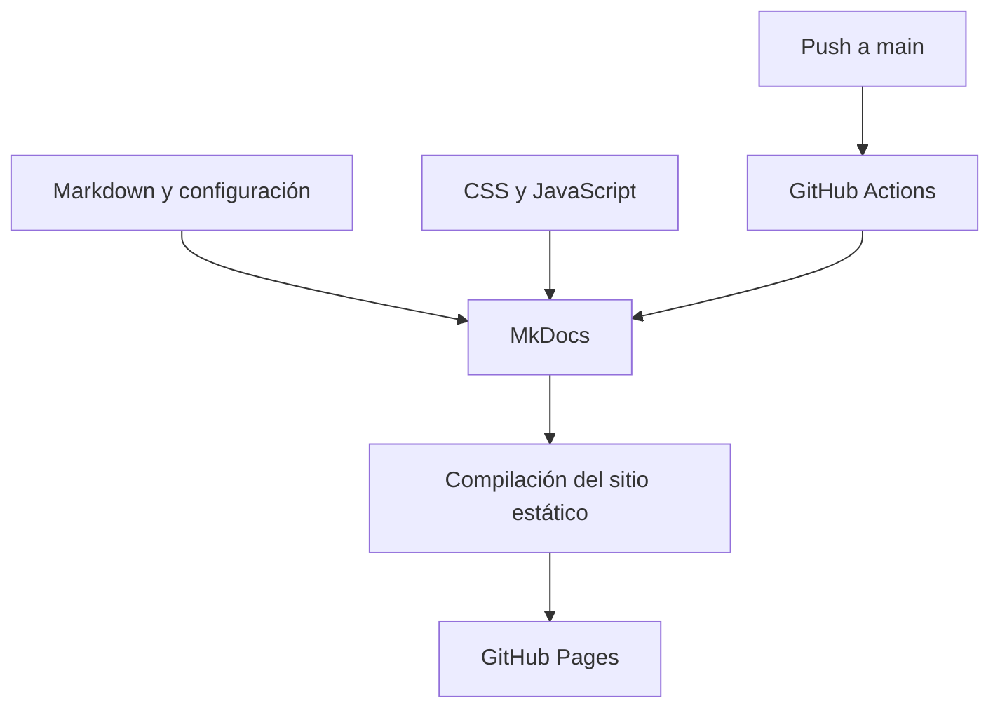

# DEVELOPMENT.md — Arquitectura y desarrollo

## 1. Propósito

Describir cómo instalar, ejecutar, mantener y publicar la Wiki de Sistemas Operativos 1.

## 2. Stack tecnológico

- **MkDocs:** genera un sitio estático desde archivos Markdown.
- **Material for MkDocs:** tema de navegación, búsqueda, tablas y diseño adaptable.
- **Markdown + Mermaid:** documentación, tablas y diagramas como código.
- **JavaScript sin dependencias:** simuladores de Round Robin, traducción de direcciones y ajuste de memoria.
- **Git y GitHub Actions:** control de versiones, compilación y despliegue automático.

Se elige un generador estático porque el proyecto es principalmente documental: facilita versionado, revisión de cambios, hosting económico y despliegues reproducibles. Los simuladores ejecutan cálculos en el navegador y no requieren una base de datos ni servidor de aplicación.

## 3. Arquitectura lógica



## 4. Levantar el proyecto localmente

1. Instalar Python 3 y Git.
2. Crear un entorno virtual: `python -m venv .venv`.
3. Activarlo: Windows PowerShell `.venv\\Scripts\\Activate.ps1`; Linux/macOS `source .venv/bin/activate`.
4. Instalar: `pip install -r requirements.txt`.
5. Ejecutar: `mkdocs serve`.
6. Abrir la URL local indicada por la terminal.
7. Compilar con `mkdocs build --strict` antes de hacer commit.

## 5. Flujo de trabajo con Git

```bash
git init
git add .
git commit -m "Inicializa wiki de sistemas operativos"
git branch -M main
git remote add origin https://github.com/TU_USUARIO/wiki-sistemas-operativos.git
git push -u origin main
```

Para cambios posteriores:

```bash
git add .
git commit -m "Actualiza unidad o simulador"
git push
```

Reemplaza `TU_USUARIO` por el usuario real y crea previamente el repositorio remoto.

## 6. Pipeline CI/CD

El archivo `.github/workflows/deploy.yml` se ejecuta cuando hay un push a `main` o se solicita manualmente. El pipeline:

1. Descarga el repositorio.
2. Configura Python.
3. Instala dependencias.
4. Construye el sitio con `mkdocs build --strict`.
5. Sube la carpeta `site` como artefacto de Pages.
6. Publica el artefacto en GitHub Pages.

En el repositorio debe configurarse **Settings → Pages → Build and deployment → GitHub Actions**. Si el build falla, revisa el registro de la acción antes de publicar.

## 7. Decisiones y limitaciones

- El contenido se almacena en Markdown para facilitar revisión y control de versiones.
- Los diagramas Mermaid permiten editar diagramas como texto.
- Los simuladores son modelos pedagógicos; no emulan todos los detalles de Linux, del hardware ni de los algoritmos reales de cada SO.
- La calculadora de paginación supone que la página indicada está presente y que el marco introducido corresponde a esa página.
- Round Robin supone que todos los procesos llegan en el tiempo cero y que las ráfagas son positivas.
- No se recopilan datos personales ni se necesita una base de datos.

## 8. Lista de verificación antes de entregar

- [ ] Sustituir `TU_USUARIO` en configuración y documentación.
- [ ] Personalizar autor, institución, curso, sección y fecha.
- [ ] Revisar ortografía y ampliar explicaciones con redacción propia.
- [ ] Probar los comandos y ejemplos de código.
- [ ] Ejecutar los tres simuladores en móvil y escritorio.
- [ ] Ejecutar `mkdocs build --strict` sin errores.
- [ ] Confirmar que el pipeline de GitHub Actions terminó correctamente.
- [ ] Abrir la URL publicada y probar navegación, búsqueda y enlaces.
- [ ] Mantener un registro de cambios por sprint.
- [ ] Añadir bibliografía y atribución de recursos externos usados realmente.

## 9. Bitácora de sprints propuesta

| Sprint | Alcance | Evidencia esperada |
|---|---|---|
| 1 | Estructura base, despliegue inicial, unidades 1 y 2 | Commit inicial, páginas publicadas, diagrama de estados y simulador Round Robin |
| 2 | Unidades 3 y 4 | Sección crítica, sincronización, Coffman y RAG documentados; pruebas de ejemplos |
| 3 | Unidad 5 y pulido general | Calculadora de memoria, buscador, revisión móvil, enlaces y documentación final |

Registra en cada sprint la fecha, integrantes, tareas realizadas, commits, problemas encontrados y cómo se resolvieron. No declares tareas como terminadas hasta comprobarlas.
