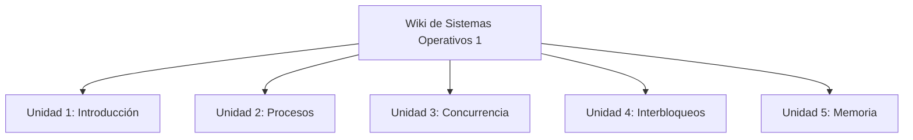

# Wiki de Sistemas Operativos 1

## Presentación

Esta Wiki reúne conceptos esenciales de los sistemas operativos, desde su función como administrador de recursos hasta los mecanismos de concurrencia y la administración de memoria. Está organizada en las cinco unidades del proyecto académico y combina explicaciones, tablas, diagramas y ejemplos reproducibles.

## Objetivo general

Explicar y ejemplificar los fundamentos de los sistemas operativos para comprender cómo administran procesadores, procesos, recursos compartidos y memoria, y cómo protegen la ejecución de los programas.

## Objetivos específicos

- Describir la función del sistema operativo y su evolución.
- Analizar estados, estructuras y planificación de procesos.
- Explicar problemas de concurrencia y mecanismos de sincronización.
- Identificar condiciones de interbloqueo y comparar estrategias para tratarlos.
- Aplicar técnicas de asignación y traducción de memoria.
- Documentar el desarrollo con Markdown, Git y despliegue automatizado.

## Mapa del contenido

## Cómo estudiar

1. Lee los conceptos de cada unidad.
2. Revisa los diagramas y ejemplos.
3. Ejecuta los ejemplos de código en un entorno seguro.
4. Usa los simuladores para comprobar cómo cambian los resultados al modificar los datos.
5. Consulta las referencias al final de cada unidad y registra cualquier ampliación propia.

> **Nota académica:** este material es una base desarrollada para el proyecto. Conviene que el estudiante lo revise, lo adapte a las indicaciones del docente y compruebe los ejemplos antes de entregar.
