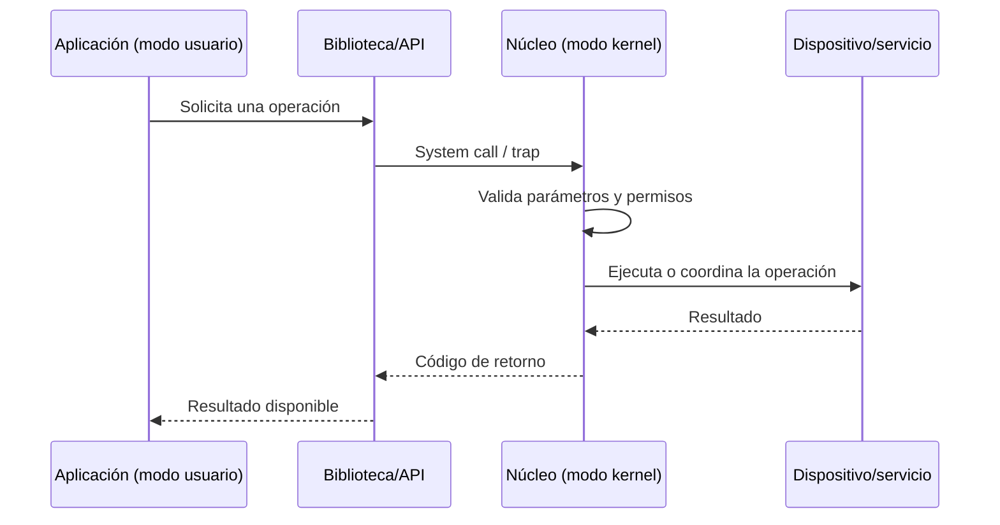

# Unidad 1. Introducción a los sistemas operativos

## 1.1 Definición y función

Un **sistema operativo (SO)** es el conjunto de software que administra los recursos de una computadora y ofrece servicios a los programas y usuarios. Coordina el procesador, la memoria principal, los dispositivos de entrada/salida, los archivos y la seguridad.

Puede entenderse desde dos perspectivas:

- **Gestor de recursos:** distribuye CPU, memoria, almacenamiento y dispositivos entre los programas, intentando que se utilicen de manera eficiente y justa.
- **Máquina virtual o capa de abstracción:** oculta detalles físicos complejos y ofrece interfaces más simples, como archivos, procesos y llamadas al sistema.

### Funciones principales

| Función | Descripción | Ejemplo |
|---|---|---|
| Gestión de procesos | Crea, planifica y termina procesos | Ejecutar un navegador y un editor a la vez |
| Gestión de memoria | Asigna y protege memoria | Separar la memoria de dos aplicaciones |
| Sistema de archivos | Organiza datos persistentes | Crear carpetas y guardar documentos |
| Entrada/salida | Coordina dispositivos y controladores | Leer desde teclado o escribir en pantalla |
| Seguridad | Controla acceso y privilegios | Permisos de lectura de un archivo |
| Red | Facilita comunicación entre equipos | Enviar datos por TCP/IP |

## 1.2 Evolución histórica

| Etapa | Características | Ventaja y limitación |
|---|---|---|
| Monitores residentes | Un programa monitor automatizaba la secuencia de trabajos | Menos intervención manual, pero poca interacción |
| Procesamiento por lotes (*batch*) | Trabajos agrupados y ejecutados sin interacción continua | Aprovecha operaciones repetitivas; respuesta tardía |
| Multiprogramación | Varios trabajos permanecen en memoria | La CPU puede trabajar mientras otro proceso espera E/S |
| Tiempo compartido | CPU distribuida en intervalos entre usuarios/procesos | Interactividad; requiere planificación y protección |
| Sistemas distribuidos | Equipos conectados cooperan y comparten recursos | Escalabilidad; aumenta la complejidad de coordinación |
| Tiempo real | Respuestas sujetas a plazos temporales | Útil en control industrial; el plazo es parte de la corrección |
| Virtualización y contenedores | Aislamiento mediante máquinas virtuales o espacios de usuario compartidos | Portabilidad y mejor aprovechamiento; hay sobrecarga y límites de aislamiento distintos |

## 1.3 Llamadas al sistema y protección

Una **llamada al sistema** es la interfaz controlada por la que un programa solicita un servicio privilegiado al núcleo. Ejemplos típicos son abrir un archivo, crear un proceso, reservar memoria o enviar datos por un dispositivo.

Flujo simplificado:



- **Modo usuario:** limita las instrucciones y accesos disponibles para una aplicación normal.
- **Modo kernel o supervisor:** permite ejecutar operaciones privilegiadas necesarias para administrar hardware y recursos.
- **Interrupción:** señal que requiere atención del procesador, normalmente relacionada con hardware o eventos externos.
- **Trap/excepción:** transferencia de control provocada por una instrucción, una condición excepcional o una llamada al sistema, según la arquitectura.

La separación evita que cualquier programa manipule directamente el hardware o la memoria de otros procesos. El núcleo valida solicitudes porque una llamada maliciosa o incorrecta no debe comprometer todo el sistema.

## 1.4 Clasificación de los sistemas operativos

| Clasificación | Significado | Ejemplo orientativo |
|---|---|---|
| Monousuario / multiusuario | Atiende a uno o varios usuarios con cuentas y permisos | Equipo personal / servidor multiusuario |
| Monotarea / multitarea | Ejecuta una tarea o alterna entre múltiples tareas | Sistemas simples embebidos / Linux de escritorio |
| Centralizado / distribuido | Recursos concentrados en un equipo o coordinados entre varios | Equipo aislado / clúster distribuido |
| Embebido | Diseñado para un dispositivo o función específica | Controlador de electrodoméstico |
| Tiempo real | Busca cumplir restricciones temporales definidas | Control de frenos o automatización |

Las categorías no son mutuamente excluyentes: un SO puede ser multiusuario, multitarea y admitir características de tiempo real.

## 1.5 Ejemplo práctico: consultar procesos en Linux

```bash
# Muestra procesos con información de usuario y uso de recursos
ps aux

# Muestra procesos en tiempo real; salir con q
top

# Identifica el núcleo y la arquitectura
uname -a
```

**Interpretación:** `ps` presenta una instantánea de procesos; `top` actualiza métricas; `uname` informa datos del sistema. Los comandos disponibles y sus opciones pueden variar entre distribuciones.

## Preguntas de repaso

1. ¿Por qué el sistema operativo se considera gestor de recursos y máquina de abstracción?
2. ¿Qué diferencia existe entre modo usuario y modo kernel?
3. ¿Por qué una llamada al sistema no debe aceptar parámetros sin validación?
4. ¿Qué ventaja aportó la multiprogramación frente al procesamiento por lotes simple?
5. ¿Por qué un sistema de tiempo real se evalúa también por el cumplimiento de plazos?

## Referencias sugeridas

- Silberschatz, Galvin y Gagne, *Operating System Concepts*.
- Tanenbaum y Bos, *Modern Operating Systems*.
- Documentación oficial del kernel Linux: https://docs.kernel.org/
