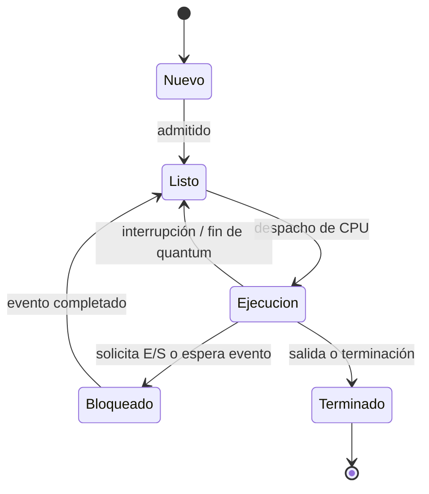

# Unidad 2. Definición y control de procesos

## 2.1 Programa y proceso

Un **programa** es un conjunto pasivo de instrucciones almacenadas. Un **proceso** es una instancia en ejecución de un programa, con estado, contexto de CPU, espacio de direcciones y recursos asociados. Dos procesos pueden ejecutar el mismo programa, pero tener datos y estados independientes.

## 2.2 Estados de un proceso

| Estado | Significado |
|---|---|
| Nuevo | Está siendo creado y preparado |
| Listo | Puede usar CPU, pero espera turno |
| Ejecución | Sus instrucciones se ejecutan en una CPU |
| Bloqueado/espera | Espera un evento, como terminar una operación de E/S |
| Terminado | Finalizó o fue detenido |



## 2.3 Bloque de Control de Proceso (PCB)

El **PCB (Process Control Block)** es la estructura del núcleo que conserva la información necesaria para administrar y reanudar un proceso. Los campos concretos dependen del sistema operativo.

- Identificador del proceso (PID) y, cuando aplica, PID del padre.
- Estado actual y prioridad.
- Contador de programa y registros de CPU guardados.
- Información de planificación y contabilidad.
- Información de memoria: tablas, límites o referencias a estructuras de memoria.
- Descriptores de archivos y recursos asociados.

## 2.4 Cambio de contexto

Un **context switch** ocurre cuando el SO deja de ejecutar un proceso o hilo y prepara otro. El núcleo guarda el contexto del que sale, elige al siguiente y restaura su contexto. Este trabajo tiene un costo: durante parte del cambio no se ejecuta trabajo útil de la aplicación. El costo depende del hardware, del SO y de qué recursos deban cambiarse.

## 2.5 Creación y terminación

Los procesos pueden crearse al iniciar aplicaciones, servicios o tareas. En sistemas tipo Unix, `fork()` crea un proceso hijo y `exec()` sustituye la imagen del proceso por otro programa; otros sistemas utilizan mecanismos diferentes. Un proceso termina normalmente al completar su trabajo, o puede ser terminado por un error o una decisión autorizada del sistema.

## 2.6 Proceso frente a hilo

| Característica | Proceso | Hilo |
|---|---|---|
| Espacio de direcciones | Generalmente propio y aislado | Comparte el espacio del proceso con otros hilos |
| Estado de ejecución | Tiene contexto propio | Cada hilo tiene registros, contador y pila propios |
| Recursos | Administra recursos como archivos y memoria | Suele compartir recursos del proceso |
| Comunicación | Puede requerir IPC explícito | Compartir datos puede ser sencillo, pero exige sincronización |
| Costo | Crear/cambiar puede ser relativamente más costoso | Normalmente más ligero, según la implementación |
| Fallos | El aislamiento puede limitar daños | Un fallo grave puede afectar al proceso completo |

## 2.7 Planificación Round Robin

Round Robin asigna a cada proceso listo un intervalo máximo de CPU llamado **quantum**. Si no termina durante ese intervalo, vuelve al final de la cola de listos. Es apropiado para sistemas interactivos porque reparte oportunidades de CPU.

- Quantum demasiado pequeño: mejora la capacidad de respuesta, pero incrementa cambios de contexto.
- Quantum demasiado grande: reduce cambios de contexto, pero se parece a FCFS y puede aumentar la espera de otros procesos.

### Ejemplo manual

Procesos con llegada en tiempo 0: P1 necesita 5 unidades, P2 necesita 3 y P3 necesita 1; quantum = 2.

| Intervalo | Proceso | Tiempo restante después |
|---|---|---:|
| 0–2 | P1 | 3 |
| 2–4 | P2 | 1 |
| 4–5 | P3 | 0 |
| 5–7 | P1 | 1 |
| 7–8 | P2 | 0 |
| 8–9 | P1 | 0 |

Gantt: `0–2 P1 | 2–4 P2 | 4–5 P3 | 5–7 P1 | 7–8 P2 | 8–9 P1`.

```python
from collections import deque

def round_robin(burst_times, quantum):
    """Simulación simple: todos los procesos llegan en tiempo 0."""
    if quantum <= 0 or any(t < 0 for t in burst_times.values()):
        raise ValueError("Quantum debe ser positivo y los tiempos no negativos")
    remaining = dict(burst_times)
    queue = deque(burst_times.keys())
    time = 0
    gantt = []
    while queue:
        p = queue.popleft()
        run = min(quantum, remaining[p])
        if run == 0:
            continue
        gantt.append((time, time + run, p))
        time += run
        remaining[p] -= run
        if remaining[p] > 0:
            queue.append(p)
    return gantt

print(round_robin({"P1": 5, "P2": 3, "P3": 1}, 2))
```

## Preguntas de repaso

1. ¿Cuál es la diferencia entre un programa y un proceso?
2. ¿Qué información permite guardar el PCB?
3. ¿Qué eventos hacen que un proceso pase de ejecución a bloqueado?
4. ¿Por qué un cambio de contexto representa una sobrecarga?
5. ¿Qué ocurre con el tiempo de respuesta y la sobrecarga si el quantum es muy pequeño?

## Referencias sugeridas

- Silberschatz, Galvin y Gagne, *Operating System Concepts*.
- Manuales de Linux: `man fork`, `man exec`, `man ps`.

## 2.4 Procesos y Threads (Hilos)

### 📌 ¿Qué es un Hilo?

Un **hilo** es la unidad más pequeña de ejecución secuencial de instrucciones que un sistema operativo puede planificar y gestionar. Cada hilo forma parte de un proceso, y varios hilos dentro del mismo proceso comparten recursos entre sí.

---

### 🔄 Diferencia entre Proceso y Hilo

| Característica | Proceso | Hilo |
|---|---|---|
| **Definición** | Programa en ejecución | Flujo de ejecución dentro de un proceso |
| **Espacio de memoria** | Tiene su propio espacio de memoria privado | Comparte el espacio de memoria del proceso al que pertenece |
| **Creación** | Más costosa en tiempo y recursos | Más ligera y rápida de crear |
| **Comunicación** | Requiere mecanismos especiales (tuberías, colas, señales) | Pueden comunicarse mediante variables compartidas del proceso |
| **Cambio de contexto** | Más lento | Más rápido y con menor sobrecarga |
| **Independencia** | Es independiente de otros procesos | Depende del proceso que lo contiene |

---

### 🧠 Recursos compartidos y privados

#### ✅ Recursos COMPARTIDOS entre hilos de un mismo proceso:
- Espacio de direcciones / memoria virtual
- Archivos abiertos
- Señales y manejadores de señales
- Tabla de páginas de memoria

#### 🔒 Recursos PRIVADOS de cada hilo:
- Contador de programa — indica qué instrucción ejecuta
- Registros de la CPU — valores propios de cada hilo
- Pila — para sus llamadas a funciones y variables locales
- Estado del hilo

---

### 💡 En resumen

> Un proceso es como una "aplicación completa", mientras que los hilos son las "tareas internas" que realiza esa aplicación al mismo tiempo.

- Crear un hilo es **mucho más rápido** que crear un proceso
- Los hilos de un mismo proceso **comparten la memoria**
- Si el proceso termina, **todos sus hilos terminan con él**
-
