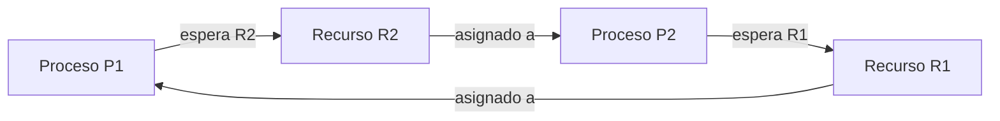

# Unidad 4. Interbloqueos (Deadlocks)

## 4.1 Definición

Un **interbloqueo** ocurre cuando un conjunto de procesos queda detenido porque cada uno espera un recurso o evento que solo puede producir otro integrante del conjunto. Ninguno puede avanzar con los recursos disponibles y sin intervención externa.

Ejemplo cotidiano: una persona tiene la llave A y necesita la llave B; otra tiene la llave B y necesita la llave A. Si ninguna libera lo que posee, ambas esperan indefinidamente.

## 4.2 Las cuatro condiciones de Coffman

Para que exista el interbloqueo clásico deben darse simultáneamente estas condiciones necesarias:

1. **Exclusión mutua:** al menos un recurso no puede compartirse simultáneamente.
2. **Retención y espera:** un proceso conserva recursos mientras espera otros.
3. **No expropiación:** los recursos no se retiran forzosamente; el proceso debe liberarlos.
4. **Espera circular:** existe una cadena cerrada de procesos, cada uno esperando un recurso retenido por el siguiente.

## 4.3 Estrategias de tratamiento

| Estrategia | Idea | Ventaja | Limitación |
|---|---|---|---|
| Prevención | Diseñar el sistema para romper al menos una condición de Coffman | Evita la clase de interbloqueo prevista | Puede reducir utilización o flexibilidad |
| Evitación | Conceder una solicitud solo si el estado resultante es seguro | Evita entrar en estados inseguros bajo supuestos conocidos | Requiere información de necesidades máximas y tiene costo de comprobación |
| Detección y recuperación | Permitir que ocurra, detectarlo y actuar | No limita tanto las solicitudes de antemano | Detección y recuperación pueden ser costosas |
| Avestruz | Ignorar el problema cuando su probabilidad/costo esperado es bajo | Simplicidad en ciertos escenarios | No es adecuado si el fallo tiene consecuencias graves |

### Prevención

Se puede evitar la retención y espera exigiendo solicitar todos los recursos antes de empezar; eliminar la espera circular imponiendo un orden global de adquisición; o hacer compartible un recurso cuando sea técnicamente posible. Cada política tiene restricciones prácticas.

### Evitación: algoritmo del banquero

El algoritmo del banquero determina si una asignación mantiene un **estado seguro**. Un estado es seguro si existe al menos una secuencia en la que cada proceso puede recibir los recursos que aún necesita, terminar y devolverlos para que continúe el siguiente.

Definiciones para cada proceso:

- `Available`: recursos libres disponibles.
- `Allocation`: recursos actualmente asignados.
- `Max`: máximo declarado que podría necesitar.
- `Need = Max - Allocation`: recursos que aún podría requerir.

Procedimiento simplificado de comprobación de seguridad:

1. `Work = Available` y marcar todos los procesos como no terminados.
2. Buscar un proceso no terminado con `Need <= Work` en todos los tipos de recurso.
3. Simular su finalización y sumar su asignación: `Work = Work + Allocation`.
4. Repetir. Si todos pueden terminar, el estado es seguro; si no se encuentra proceso elegible mientras quedan procesos, es inseguro.

**Inseguro no significa necesariamente interbloqueado**: significa que no se puede demostrar la existencia de una secuencia segura con la información del modelo.

## 4.4 Detección con grafo de asignación de recursos (RAG)

Un grafo RAG representa procesos y recursos: una arista proceso → recurso indica solicitud; una arista recurso → proceso indica asignación. Para recursos de una sola instancia, un ciclo en el grafo indica interbloqueo. Con múltiples instancias, un ciclo por sí solo no basta para concluir que hay interbloqueo.

## 4.5 Recuperación

- **Terminar procesos:** abortar todos los involucrados o seleccionar uno por vez hasta romper el ciclo.
- **Expropiar recursos:** recuperar un recurso y reasignarlo, si es seguro y técnicamente posible.
- **Rollback:** volver a un punto seguro anterior si el sistema dispone de puntos de recuperación.

La selección debe considerar prioridad, trabajo ya realizado, recursos retenidos y consecuencias de perder resultados. La recuperación repetida del mismo proceso puede provocar inanición.

## 4.6 Enfoque del avestruz

Consiste en aceptar el riesgo y no implementar una solución específica cuando la frecuencia esperada del problema y el costo de resolverlo superan el beneficio, o cuando otras capas ya limitan el impacto. No significa que todos los sistemas modernos ignoren los interbloqueos ni que sea siempre una decisión correcta; es una compensación de ingeniería dependiente del contexto.

## Preguntas de repaso

1. ¿Cuáles son las cuatro condiciones de Coffman?
2. ¿Qué diferencia existe entre prevención y evitación?
3. ¿Qué significa que un estado sea seguro?
4. ¿Por qué un estado inseguro no equivale necesariamente a un interbloqueo actual?
5. ¿Qué alternativas de recuperación existen y qué riesgos presentan?

## Referencias sugeridas

- Silberschatz, Galvin y Gagne, *Operating System Concepts*.
- Tanenbaum y Bos, *Modern Operating Systems*.
